<p align="center">
  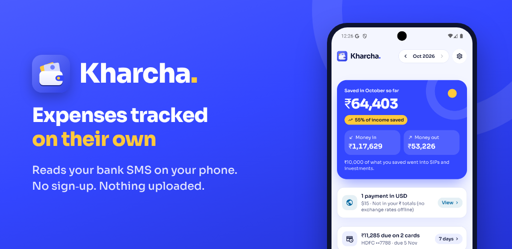
</p>

# Kharcha

**An Android expense tracker that reads your bank SMS on your phone, and nowhere else.**

Kharcha turns bank and card messages into a clear picture of your money: what you spent, what came in, what you saved, what you owe on credit cards, and where every rupee went. No account, no server of our own, no bank login. Nothing you track ever leaves the phone.

Built with **React Native + Expo (SDK 58)**, Expo Router, Reanimated, and a small native Kotlin module that reads the SMS inbox.

---

## Screenshots

Every screen comes in a light and a dark theme. Pick **Auto** (follows your phone), **Light** or **Dark** in Settings, plus an accent colour for each.

<table>
  <tr>
    <th></th>
    <th>Home</th>
    <th>Insights</th>
    <th>Activity</th>
  </tr>
  <tr>
    <th>Light</th>
    <td>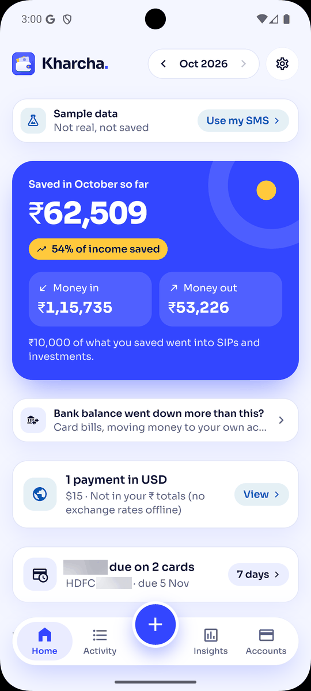</td>
    <td>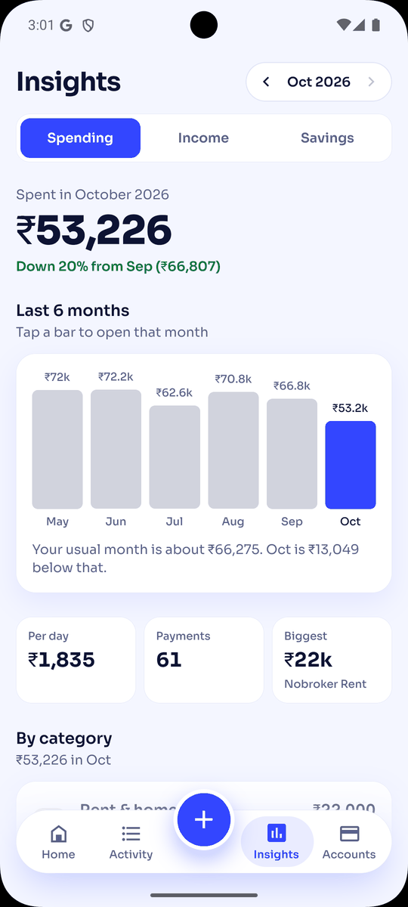</td>
    <td>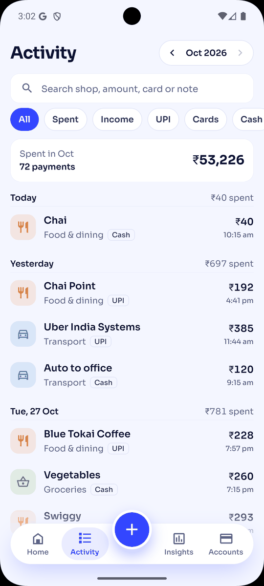</td>
  </tr>
  <tr>
    <th>Dark</th>
    <td>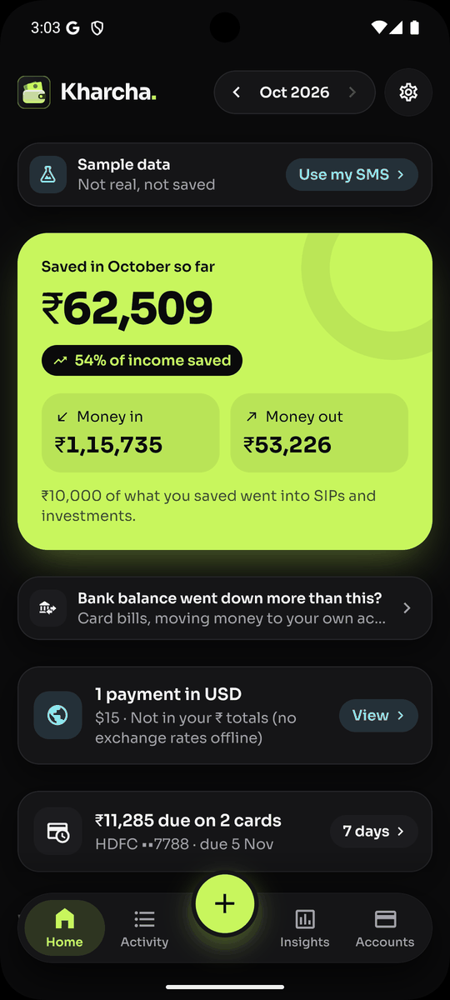</td>
    <td>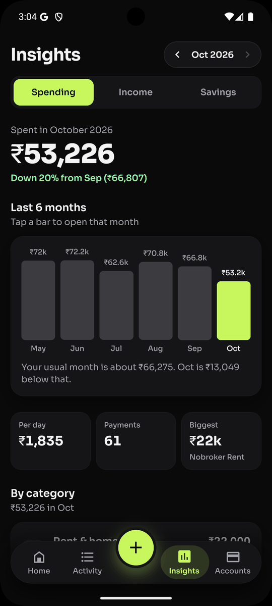</td>
    <td>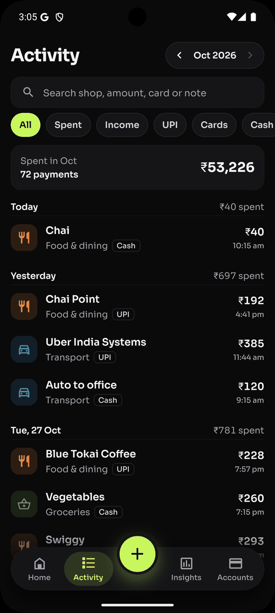</td>
  </tr>
  <tr>
    <td></td>
    <td>This month at a glance</td>
    <td>Spending, income and savings over 6 months</td>
    <td>Every payment, searchable</td>
  </tr>
</table>

<table>
  <tr>
    <th></th>
    <th>Where your money went</th>
    <th>Credit cards</th>
    <th>Investments</th>
  </tr>
  <tr>
    <th>Light</th>
    <td>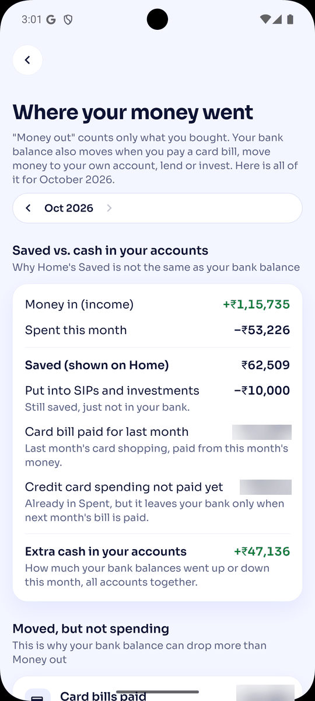</td>
    <td>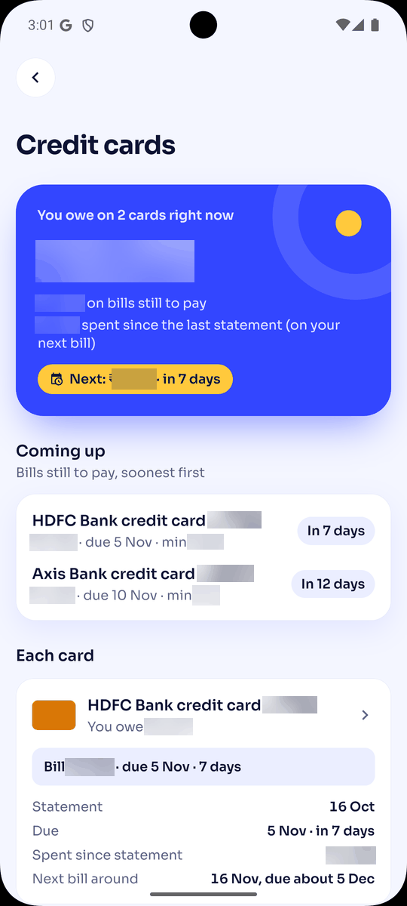</td>
    <td>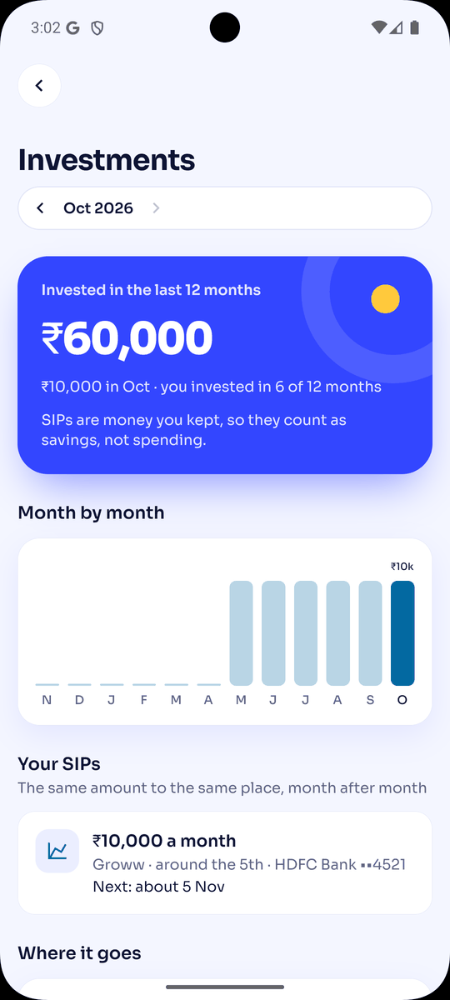</td>
  </tr>
  <tr>
    <th>Dark</th>
    <td>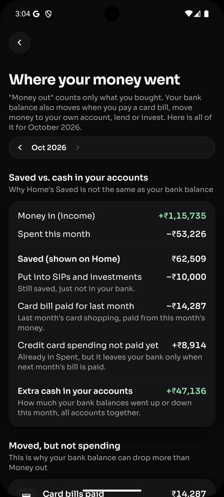</td>
    <td>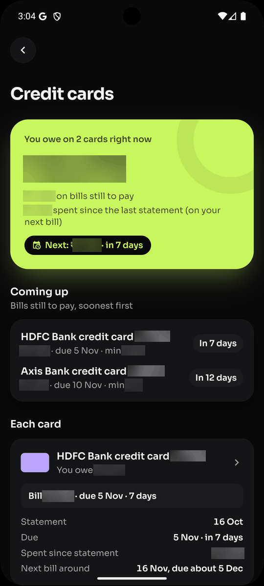</td>
    <td>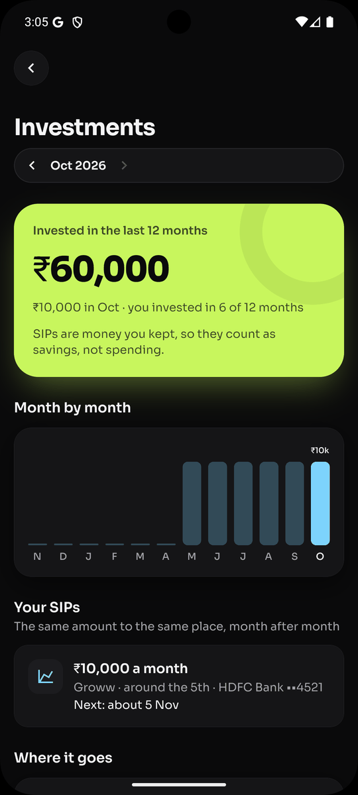</td>
  </tr>
  <tr>
    <td></td>
    <td>Why your bank balance differs from "money out"</td>
    <td>What you owe, due dates, days left</td>
    <td>SIPs, next dates, missing SIP messages</td>
  </tr>
</table>

Screenshots use the app's built-in sample data, not a real person's messages. Play Store images are in [`store/android/`](store/android/).

---

## What it does

### Tracks every payment on its own
- Reads bank, card and UPI messages from the last 13 months, and keeps reading new ones.
- Skips OTPs, offers, reminders, failed payments and money requests.
- Finds the amount, the shop or person, the account or card, and how you paid (UPI, card, ATM, net banking).
- Puts each payment in a category (Food, Groceries, Rent, Bills, Software & online, Cook & house help…).
- Works with HDFC, SBI, ICICI, Axis, Kotak, IDFC, slice, Paytm and most Indian banks.

### Counts money correctly, without counting anything twice
- **Moving money between your own accounts** (HDFC → slice) is not spending or income.
- **Paying a credit card bill** is not spending again: the shopping counted the day you bought it.
- **Refunds** are taken off the purchase they belong to.
- **Money paid back to you** (a company reimbursing a work expense) cancels the expense.
- **SIPs and investments** count as savings, not spending.
- **Loans:** money lent or borrowed is neither spending nor income.
- **"Paid twice?"**: the same bill paid from two accounts on the same day is flagged for you to check.

### Shows the full picture
| Screen | What you see |
| --- | --- |
| **Home** | Money in, money out and saved this month, credit card bills due, top categories, latest payments |
| **Activity** | Every payment by day, with search and filters, and payments that need a look |
| **Insights** | Spending, income and savings over 6 months, categories, top shops, who paid you, day of the week |
| **Accounts** | How you paid, each bank account and card, credit card bills |
| **Where your money went** | Why your bank balance differs from "money out": card bills, own-account moves, investments, and each account's change |
| **Credit cards** | What you owe now, each bill's due date and days left, which payment paid it, payments to check |
| **Investments** | SIPs by month, each SIP's usual day and next date, scheduled SIPs with no payment message |
| **Who you pay** | Tag a person once (room rent, cook, family, lent money…) and all their payments move to the right place |
| **Sort "Other"** | Shops Kharcha couldn't place, grouped: pick a category once per shop and every payment moves |
| **Payment details** | The original SMS, category, links to related payments, and a switch to leave it out |
| **Goals and budget** | Savings goals and a monthly spending limit with daily pace |

### Fits how you live
- **Your month can start on any day** (1st to 28th), for example the day your salary comes in.
- **Your corrections always win:** change a category once and it applies to every payment from that shop or person. (Not for payments whose SMS named no shop, like "UPI payment": those change one at a time.)
- **Your corrections survive a new phone:** they are tied to the message itself, not to Android's row number, so a restored SMS backup keeps them.
- **Cash expenses** you add by hand, for things the bank never sees.
- **Light, dark or Auto** (follows your phone), with four accent colours for each theme.
- Multiple currencies (payments in another currency are shown but kept out of totals).

---

## Privacy

- SMS is read **only on the phone**. Messages from personal numbers (and offers from promotional senders) are dropped inside the native module, so chats never reach the app code.
- No account, no analytics, no server of our own. Your corrections, goals and cash entries are saved in the app's private storage on the phone.
- The bank alerts the app uses are kept in a file in that private storage, so the next start reads only new messages. OTPs, offers and chats are never kept. The file is deleted when SMS access is turned off or you delete all data.
- App fixes arrive through Expo's update service (EAS Update). That check sends the app version, channel and a random install ID, never your data.
- Full policy: [PRIVACY.md](PRIVACY.md) (also shown in the app under Settings).

---

## Run it

You need Node.js 20+, the Android SDK (Android Studio or just the SDK and platform tools), and an Android phone with **USB debugging** on, or an emulator.

```bash
npm install
npx expo run:android      # builds and installs a development build; later changes reload instantly
```

Open the app and tap **Allow SMS access**.

> **Why not Expo Go?** Expo Go can't read SMS. That needs the native code in `modules/sms-reader`, so `npx expo run:android` makes a development build that includes it.

To install it next to the Play Store version, build with `APP_VARIANT=development` (the EAS `development` profile does this): it installs as **Kharcha Dev** (`com.mayankjha.kharcha.dev`, see `app.config.ts`).

### Try it with your own SMS on an emulator

For checking the reader against real messages without changing app code:

1. Export your inbox with `adb` into `private/sms-dump.txt` (the steps are at the top of `scripts/scan-sms.ts`).
2. `npm run scan:sms` writes what it found to `private/` (parsed payments, possible misses, and an inbox for the emulator).
3. Development builds can load that inbox from the debugger.

`private/` is git-ignored. Never commit it.

---

## Commands

| Command | What it does |
| --- | --- |
| `npm run android` | Build and run on a phone or emulator |
| `npm test` | All checks (Vitest): SMS reader, tracking, currency, updates, money flow, months, cards, investments, cache |
| `npm run test:watch` | The same, re-run on every save |
| `npm run golden` | Before/after check on your own exported SMS (`-- --update` saves a new baseline) |
| `npm run e2e` | Maestro tap-through tests on an emulator or phone (see `.maestro/`) |
| `npm run typecheck` | TypeScript check |
| `npm run lint` | Lint |
| `npm run scan:sms` | Run the SMS reader over an exported inbox (see above) |
| `npm run release:patch` | Release a new version to Google Play (see Releasing) |
| `npm run update:production -- --message "…"` | Send a JavaScript-only fix to Play Store users without a new build (see Releasing) |

Single test files (in `tests/`): `test:parser`, `test:tracking`, `test:currency`, `test:update`, `test:flows`, `test:month`, `test:cards`, `test:invest`.

---

## How it works

```
SMS inbox ──► native module ──► cache ──► parser ──► categories ──► pipeline ──► your corrections ──► money flow ──► screens
              (drops personal    (only new   (amount,     (keywords)    (duplicates,   (rules, tags,          (transfers,
               numbers, offers)   messages)   shop, card)                card bills,    links you made)         refunds,
                                                                         SIP notices)                           pay-backs)
```

| File | Job |
| --- | --- |
| `modules/sms-reader/` | Native Kotlin module: reads the inbox, drops personal numbers and promotional offers, says when the message limit was hit |
| `src/lib/smsCache.ts` | Keeps the messages the app used; next start reads only newer ones (full re-read every 30 days or when the reader changes) |
| `src/lib/parser.ts` | Reads one SMS: amount, money in or out, shop or person, account, payment mode; card bills; scheduled SIPs |
| `src/lib/categorize.ts` | Picks a category from the shop name and message words |
| `src/lib/pipeline.ts` | Whole inbox → payments, card bills and scheduled payments; removes repeats; stable message ids |
| `src/lib/prefs.ts` | Your corrections: applying them, moving them to stable ids, cleaning up old ones |
| `src/lib/store.tsx` | App state and actions; saved with AsyncStorage |
| `src/lib/flows.ts` | Links related payments: own-account transfers, card bills, refunds, pay-backs, double payments |
| `src/lib/analytics.ts` | Monthly totals, trends, budget pace, custom month start |
| `src/lib/accounts.ts` | Accounts and cards, credit card bills and dues |
| `src/lib/moneyflow.ts` | Saved vs. cash in your accounts, each account's change |
| `src/lib/investments.ts` | SIPs, investment months, scheduled SIPs without a payment message |
| `src/lib/purposes.ts` | "What do you pay this person for?" tags |
| `src/lib/sortOther.ts` | Groups "Other" payments by shop for the Sort screen |
| `docs/MONEY_FLOW.md` | The linking rules in detail |

To teach it a new shop, add it to the keyword lists in `src/lib/categorize.ts` and add a test case in `tests/parser.test.ts`.

---

## Project layout

```
modules/sms-reader/     native module that reads SMS
src/app/                screens (Expo Router)
  (tabs)/               Home, Activity, Insights, Accounts
  txn/[id].tsx          payment details      link/[id].tsx    link two payments
  category/[id].tsx     one category         day/[date].tsx   one day
  account/[key].tsx     one account or card  cards.tsx        credit cards
  flow.tsx              where your money went
  investments.tsx       SIPs and investments people.tsx       who you pay
  sort.tsx              sort "Other" by shop
  goals.tsx, goal.tsx, budget.tsx, add.tsx, settings.tsx, privacy.tsx, welcome.tsx
src/components/         shared UI: rows, charts, cards, pickers, update gate
  insights/             the Spending, Income and Savings tabs of Insights
src/lib/                everything that isn't UI (see "How it works")
tests/                  Vitest tests for src/lib
.maestro/               Maestro tap-through tests
scripts/                SMS scan, golden check, release and version tools
docs/                   releasing, Play Console, money flow, design system
store/                  Play Store listing graphics and video
```

---

## Releasing

```bash
npm run release:patch    # 1.0.3 → 1.0.4   bug fixes and small features
npm run release:minor    # 1.0.4 → 1.1.0   bigger features
npm run release:major    # 1.x   → 2.0.0   asks everyone to update
```

Each command raises the version in `app.json`, `package.json` and `package-lock.json`, commits "Release x.y.z", tags it and pushes. The tag starts the GitHub release workflow: checks → EAS build → upload to Google Play internal testing. Then roll it out in Play Console.

**Quick fixes without a Play build:** a change to JavaScript only (parser, keywords, screens) can go straight to people's phones with `npm run update:production -- --message "Fix HDFC card alerts"`. They get it the next time they open the app. Anything native (the Kotlin module, a new library with native code, permissions) still needs `release:patch`.

Build-number rules, forced updates, quick fixes and the Play Console steps: [docs/RELEASING.md](docs/RELEASING.md) and [docs/PLAY_CONSOLE.md](docs/PLAY_CONSOLE.md).

**Google Play and SMS:** Play only allows `READ_SMS` for approved uses. Kharcha is declared as **SMS-based money management**, with SMS tracking as its main feature.

---

## License

[MIT](LICENSE) © 2026 Mayank Jha
